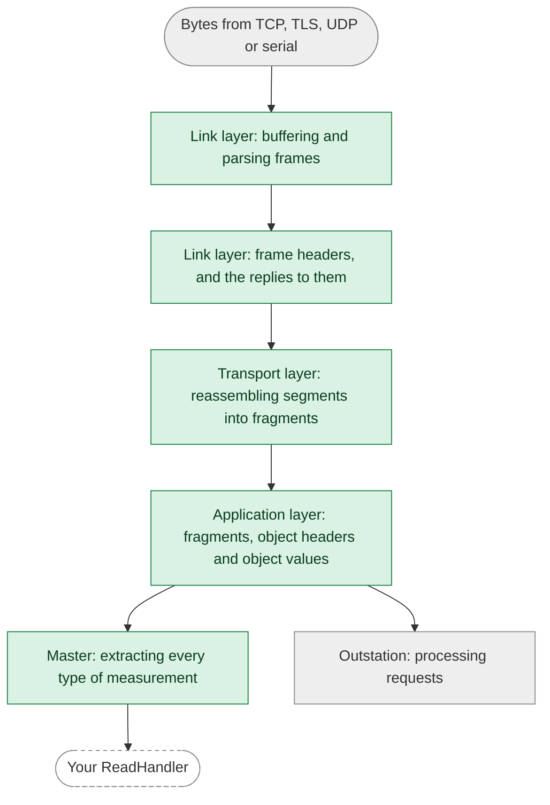

This page describes how the library defends against malformed or malicious input, and which of those defenses are
proven rather than just enforced. For how to report a vulnerability, and for how we manage dependencies, see the
[security policy](https://github.com/stepfunc/dnp3/blob/main/SECURITY.md).

## At a glance

| Defense | How | Checked by |
|---|---|---|
| [Memory safety](#memory-safety) | `unsafe` code is forbidden in the Rust library | The compiler |
| [Restricted sources of panics](#restricting-sources-of-panics) | Panic-prone constructs are denied, with documented exceptions | `clippy`, in CI |
| [Proven panic-free parsing](#proven-panic-free-parsing) | The code that decodes received bytes can't panic, whatever they contain | A link-time check, in CI |
| [Bounded resources](#bounded-resources) | Fixed buffers, and limits on how much of a request is processed | Tests |
| [Protocol validation](#protocol-validation) | IEEE 1815-2012 as amended by the technical bulletins | Tests, and [conformance testing](interoperability.mdx#conformance-testing) |
| [TLS](#tls) | rustls, mutual authentication, and only the trust you configure | rustls |

## Memory safety

The Rust library is written in safe Rust: `unsafe` code is forbidden, which the compiler enforces. The bindings for C,
C++, .NET and Java are generated from an API schema, with a thin layer of hand-written adapters. They use `unsafe` at
the boundary with the other language, where they trust the pointers and handles your application passes in. DNP3
protocol parsing is implemented in the safe Rust library, and the bindings adapt its values and iterators for your
callbacks.

## Restricting sources of panics

A panic in Rust ends the task or thread it happens in, so a panic that input can trigger is a denial-of-service
vulnerability. CI runs `clippy` on the library with these lints denied:

* `unwrap` and `expect` on `Option` and `Result`
* indexing and slicing that can go out of bounds
* arithmetic that can overflow, underflow or divide by zero
* `panic!`, `unreachable!`, `todo!` and `unimplemented!`
* slicing a string at a position that may not be a character boundary

Tests may unwrap, panic and index. In the library itself, an exception is allowed only where input can't reach it:

* the invariant that makes it safe is local and trivially true, such as indexing a 256-entry CRC table with a byte, or
* it can only fire after another panic has already happened, such as expecting that the database's mutex isn't
  poisoned.

Each exception carries a narrow `#[expect]` with a stated reason, and `#[allow]` is denied, so an exception can't go
unnoticed.

## Proven panic-free parsing

The lints restrict panics in our own code, but a call into the standard library or a dependency can still panic. So
CI also proves, at link time, that the steps that decode bytes received from the network can't panic **for any input**.
These are the steps that work directly on attacker-controlled data:



The green steps are proven panic-free. The asynchronous session code and I/O around them aren't part of the proof,
nor is the outstation's processing of the requests they decode, shown in gray. Your own handlers are code we can't
check.

<details>
<summary>How the proof works</summary>

The proof uses the [no-panic](https://github.com/dtolnay/no-panic) technique. Each function on the green path is
compiled so that a reachable panic leaves a reference to a symbol that doesn't exist, and the optimizer removes the
reference only if it can prove that no path to a panic exists. A test harness calls the functions with input read at
run time, so the optimizer can't specialize them to known values. If the test binary links, these functions can't
panic.

We confirmed that the check catches real panics by planting ones that only specific input can reach, in each layer,
and checking that each one failed the link.

</details>

:::tip Run it yourself
The `no-panic` CI job runs for every pull request and release tag, building the test binary in release mode with
link-time optimization on a pinned toolchain. To run it locally:

```
RUSTFLAGS="--cfg dnp3_no_panic" CARGO_PROFILE_RELEASE_LTO=thin CARGO_PROFILE_RELEASE_CODEGEN_UNITS=1 \
  cargo +1.99 test -p dnp3 --lib --release --no-run
```
:::

:::note What the proof doesn't cover
The outstation's processing of requests, the asynchronous session code, I/O and logging, and code you supply, such as
a `ReadHandler` or `ControlHandler`.
:::

## Additional compile-time checks

Some lints that don't concern panics are denied because the bugs they catch are silent:

* `as` conversions, which truncate or change sign without warning. Conversions use `From`, or `TryFrom` with the
  failure handled, except for a few documented conversions from floating point, where `as` is the only option.
* comparing floating-point numbers for equality, and float literals that lose precision
* discarding a `Result` or a future without naming its type

## Bounded resources

The buffers that receive and reassemble DNP3 data are allocated when a session's transport is created, at fixed sizes
derived from the configured receive fragment size. The outstation also limits how much of a request it processes:

| Setting | Default | Past the limit |
|---|---|---|
| `max_read_request_headers` | 64, which is also the minimum | Further selections or headers are ignored, the rest are answered, and the response sets IIN2.2 |
| `max_controls_per_request` | No limit | Further controls get the `TOO_MANY_OPS` status, or are skipped for requests that don't get a response |

A READ processed right away counts only the static selections it makes, so event headers and headers that select
nothing don't use up the READ limit. A READ that arrives while the outstation waits for an unsolicited confirm is held
as pending, and holding it counts each header that parses, event headers included. Device attributes have their own
fixed limit of selections per READ.

These limits bound memory, not the work of selecting what a READ reports, since a header can select every point or every
event again. The outstation also counts the points, events and attribute sets a READ's selection visits. Static points
and attribute sets may be visited 8 times each per READ, and the event buffer's slots 16 times each, but never less than
4096 times for either. A READ that exceeds either is answered with IIN2.2 and no objects. This allows any reasonable
request, even a redundant one such as reading class 0 twice, and stops requests that repeat database-wide headers
hundreds of times. It isn't configurable.

## Protocol validation

The library follows IEEE 1815-2012 as amended by the DNP Users Group technical bulletins. Examples of how it validates
input:

| Behavior | Follows |
|---|---|
| An outstation silently discards a fragment that isn't a valid request, such as one with FIR or FIN cleared, and logs a warning | IEEE 1815-2012 clause 6 |
| Transport segments are reassembled following the transport reception rules | TB2013-003 |
| IIN2.0 for a function code the outstation doesn't support, IIN2.1 for an object it doesn't support, and IIN2.2 for malformed object data or a qualifier the object doesn't support | TB2016-001 |
| An OPERATE executes only with an active selection, the next sequence number after its SELECT, object headers that match the SELECT's, and no more time elapsed than the selection timeout, and the selection is kept or ended as the table specifies | IEEE 1815-2012 4.4.4, Table 4-9 |

## TLS

TLS is implemented with [rustls](https://github.com/rustls/rustls), not OpenSSL, and is mutually authenticated.

* In `CertificateMode::AuthorityBased`, the library trusts only the certificate authority you configure: it never
  loads the operating system's trust store or any built-in set of roots.
* In `CertificateMode::SelfSigned`, the peer's certificate is compared byte for byte with the one you configure, and
  certificate chains are rejected.

See [TLS](../api/tls.mdx) for configuration.
