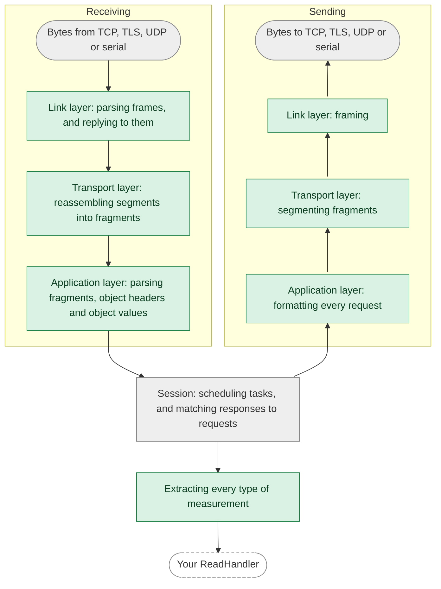
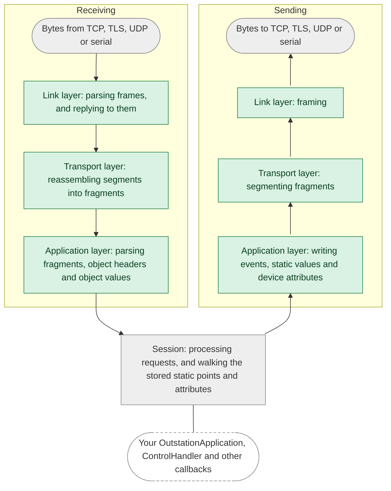

import Tabs from '@theme/Tabs';
import TabItem from '@theme/TabItem';

This page describes how the library defends against malformed or malicious input, and which of those defenses are
proven rather than just enforced. For how to report a vulnerability, and for how we manage dependencies, see the
[security policy](https://github.com/stepfunc/dnp3/blob/main/SECURITY.md).

## At a glance

| Defense | How | Checked by |
|---|---|---|
| [Memory safety](#memory-safety) | `unsafe` code is forbidden in the Rust library | The compiler |
| [Restricted sources of panics](#restricting-sources-of-panics) | Panic-prone constructs are denied, with documented exceptions | `clippy`, in CI |
| [Proven panic freedom](#proven-panic-freedom) | Parsing what is received, and formatting and framing what is sent, can't panic, whatever the input | A link-time check, in CI |
| [Bounded resources](#bounded-resources) | Fixed buffers, and limits on how much of a request is processed | Tests |
| [Protocol validation](#protocol-validation) | IEEE 1815-2012 as amended by the technical bulletins | Tests, and [conformance testing](interoperability.mdx#conformance-testing) |
| [TLS](#tls) | rustls, mutual authentication, and only the trust you configure | rustls |

## Memory safety

The Rust library is written in safe Rust: `unsafe` code is forbidden, which the compiler enforces. The bindings for C,
C++, .NET and Java are generated from an API schema, with a thin layer of hand-written adapters. They use `unsafe` at
the boundary with the other language, where they trust the pointers and handles your application passes in. DNP3
protocol parsing is implemented in the safe Rust library, and the bindings adapt its values and iterators for your
callbacks.

## Restricting sources of panics

A panic in Rust ends the task or thread it happens in, so a panic that input can trigger is a denial-of-service
vulnerability. CI runs `clippy` on the library with these lints denied:

* `unwrap` and `expect` on `Option` and `Result`
* indexing and slicing that can go out of bounds
* arithmetic that can overflow, underflow or divide by zero
* `panic!`, `unreachable!`, `todo!` and `unimplemented!`
* slicing a string at a position that may not be a character boundary
* `as` conversions, which can truncate or change sign without warning

Tests may unwrap and index. In the library, the few exceptions are places input can't reach, and each one states why.

## Proven panic freedom

The lints restrict panics in our own code, but a call into the standard library or a dependency can still panic. So
CI also proves, at link time, that the steps that parse what the library receives, and format and frame what it sends,
can't panic **for any input**, including in the standard library and dependency code they call. Each diagram follows a
request or response down from the bytes received, through the processing in your role, and back up to the bytes sent:

<Tabs
groupId="role"
defaultValue="master"
values={[
{label: 'Master', value: 'master'},
{label: 'Outstation', value: 'outstation'},
]}>
<TabItem value="master">

</TabItem>
<TabItem value="outstation">

</TabItem>
</Tabs>

The green steps are proven panic-free. The gray ones are covered by the lints but not the proof, and your own handlers
are code we can't check.

How the proof works

The proof uses the [no-panic](https://github.com/dtolnay/no-panic) technique. Each function on the green path is
compiled so that a reachable panic leaves a reference to a symbol that doesn't exist, and the optimizer removes the
reference only if it can prove that no path to a panic exists. A test harness calls the functions with input read at
run time, so the optimizer can't specialize them to known values, and with output buffers of every size from empty to
far larger than a fragment. If the test binary links, these functions can't panic.

Where a step calls code the library doesn't own, such as logging, the harness passes a stand-in, so the proof covers the
step around the call but not the call itself. CI links the test binary twice, the second time with overflow checks on,
so arithmetic overflow can't panic in these steps either.

The check fails closed: if any of these functions could panic, the test binary doesn't link, and the error names the
function. We verified this in each layer by temporarily adding a panic that only specific input could reach; each one
broke the link.

The `no-panic` job in [CI](https://github.com/stepfunc/dnp3/blob/main/.github/workflows/ci.yml) runs this check on
every pull request and release tag.

:::note What the proof doesn't cover
The asynchronous session code that schedules the master's tasks and processes the outstation's requests, the
outstation's walks and searches of its stored static points and attributes, I/O and logging, and code you supply, such
as a `ReadHandler`, an `OutstationApplication` or a `ControlHandler`.
:::

## Bounded resources

The buffers that receive DNP3 data are allocated once, at fixed sizes, when a session starts. The outstation caps how
many READ headers and controls it processes per request (`max_read_request_headers`, `max_controls_per_request`), and
budgets the work it spends on a READ or ASSIGN_CLASS, scaled to its database, so a pathological request is answered
with an error instead of consuming the CPU.

## Protocol validation

The library follows IEEE 1815-2012 as amended by the DNP Users Group technical bulletins. Requests and responses that
don't follow the standard are rejected, or answered with the error it prescribes, and select-before-operate is enforced
strictly. [Conformance testing](interoperability.mdx#conformance-testing) checks this behavior.

## TLS

TLS is implemented with [rustls](https://github.com/rustls/rustls), not OpenSSL, and is mutually authenticated.

* In `CertificateMode::AuthorityBased`, the library trusts only the certificate authority you configure: it never
  loads the operating system's trust store or any built-in set of roots.
* In `CertificateMode::SelfSigned`, the peer's certificate is compared byte for byte with the one you configure, and
  certificate chains are rejected.

See [TLS](../api/tls.mdx) for configuration.
