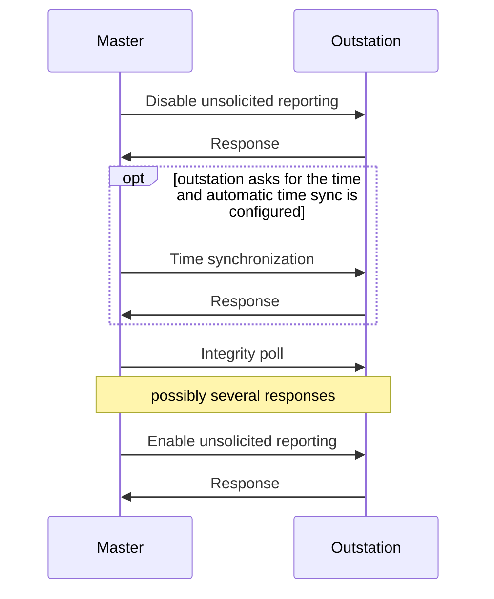

import Tabs from '@theme/Tabs';
import TabItem from '@theme/TabItem';

`AssociationConfig` sets how the master works with one outstation. The outstation's address isn't part of it: you pass
the address separately when you [create the association](./association_create.mdx). The configuration answers these
questions:

| Decision | Why it matters |
|----------|----------------|
| What to read at [startup](#initialization) | The integrity poll gives you the current value of every point, at startup and after the outstation restarts |
| Whether the outstation reports unsolicited | Which event classes the master turns off and back on at startup. Choose none for an outstation that doesn't report unsolicited, and poll it instead |
| Whether and how to synchronize time | Whether the master sets the outstation's clock when it asks for the time, and with which procedure. See [Time Synchronization](./association_handler.mdx) |
| How to react to the outstation's indications | Which event classes the master scans when the outstation reports events, and whether it runs an integrity poll when the outstation's event buffer overflows |
| How long to wait, and how to retry | How long the master waits for each response, and how it [retries automatic tasks](./scheduling.mdx#when-something-fails) that fail |
| When to check a quiet link | How long the link can be silent before the master sends a keep-alive, if at all |
| How many requests can wait | How many of your requests can queue on the association before new ones fail at once |

The examples configure an association like this:

<Tabs
groupId="language"
defaultValue="Rust"
values={[
{label: 'Rust', value: 'Rust'},
{label: 'C', value: 'C'},
{label: 'C++', value: 'C++'},
{label: 'Java', value: 'Java'},
{label: 'C#', value: 'C#'},
]}>
<TabItem value="Rust">

```rust
{{#include ../examples/master/src/main.rs:association_config}}
```

</TabItem>
<TabItem value="C">

```c
{{#include ../ffi/bindings/c/master_example.c:association_config}}
```

</TabItem>
<TabItem value="C++">

```cpp
{{#include ../ffi/bindings/c/master_example.cpp:association_config}}
```

</TabItem>
<TabItem value="Java">

```java
{{#include ../ffi/bindings/java/examples/src/main/java/io/stepfunc/dnp3/examples/MasterExample.java:association_config}}
```

</TabItem>
<TabItem value="C#">

```csharp
{{#include ../ffi/bindings/dotnet/examples/master/Program.cs:association_config}}
```

</TabItem>
</Tabs>

## Initialization

The master turns unsolicited reporting off, reads everything with an integrity poll, then turns unsolicited reporting back
on. That way it starts from the current value of every point before changes stream in. If the outstation asks for the time
and automatic time synchronization is configured, the master synchronizes it before the integrity poll:



The master skips any step whose classes you leave empty. For an outstation that doesn't support unsolicited reporting, set
the classes to disable and to enable at startup to none, and the master performs only the integrity poll.

## Scheduling

The master runs these startup tasks, and others such as clearing the restart bit and automatic event scans, alongside your
requests and polls. See [Automatic Tasks and Scheduling](./scheduling.mdx) for when each one runs and how a channel orders
the work of its associations.
