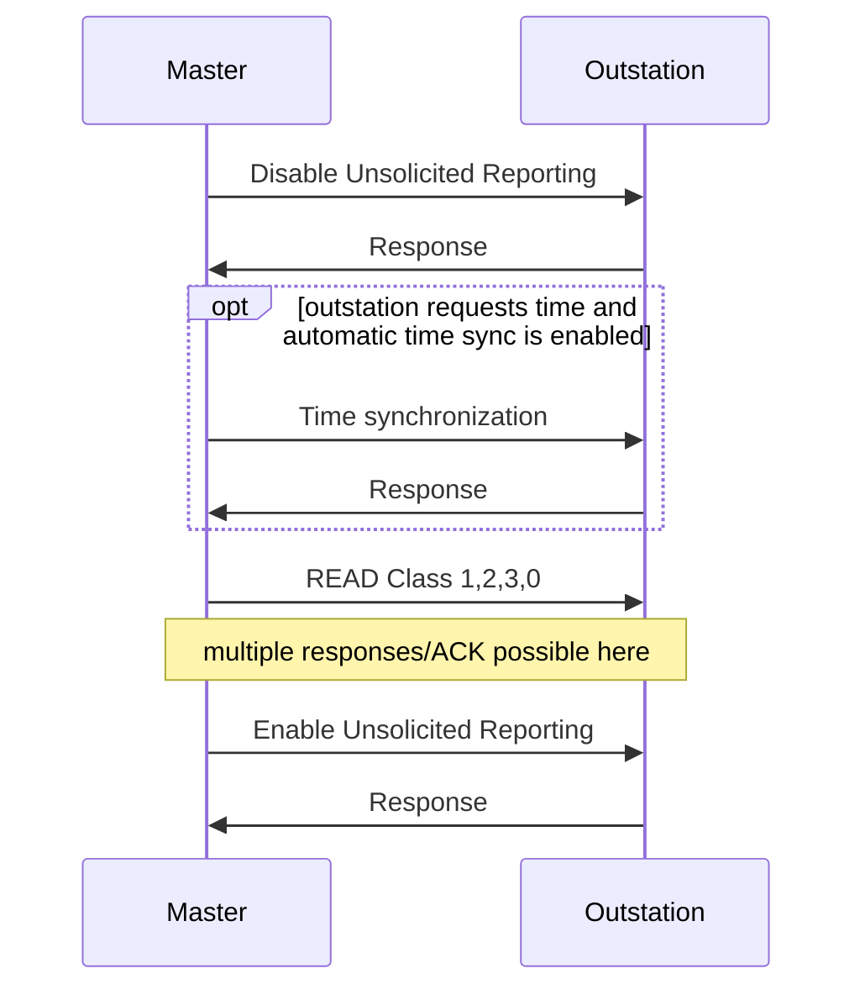

import Tabs from '@theme/Tabs';
import TabItem from '@theme/TabItem';

`AssociationConfig` configures communication with a particular outstation:

* Timeout for responses on this association
* Startup handshaking
* If and how to perform time synchronization
* Per-association task queue size

The outstation address is provided as a separate argument when adding an association to a channel.

<Tabs
groupId="language"
defaultValue="Rust"
values={[
{label: 'Rust', value: 'Rust'},
{label: 'C', value: 'C'},
{label: 'C++', value: 'C++'},
{label: 'Java', value: 'Java'},
{label: 'C#', value: 'C#'},
]}>
<TabItem value="Rust">

```rust
{{#include ../examples/master/src/main.rs:association_config}}
```

</TabItem>
<TabItem value="C">

```c
{{#include ../ffi/bindings/c/master_example.c:association_config}}
```

</TabItem>
<TabItem value="C++">

```cpp
{{#include ../ffi/bindings/c/master_example.cpp:association_config}}
```

</TabItem>
<TabItem value="Java">

```java
{{#include ../ffi/bindings/java/examples/src/main/java/io/stepfunc/dnp3/examples/MasterExample.java:association_config}}
```

</TabItem>
<TabItem value="C#">

```csharp
{{#include ../ffi/bindings/dotnet/examples/master/Program.cs:association_config}}
```

</TabItem>
</Tabs>

## Initialization

The DNP3 standard requires that the master perform these actions during initialization before normal polling can occur:



If your outstation doesn't support unsolicited reporting, set `AssociationConfig.DisableUnsolClasses` and `AssociationConfig.EnableUnsolClasses` to `EventClasses.None()`. The master will skip unsolicited configuration and only perform the integrity poll.

## Scheduling

The master runs these startup tasks, and others such as clearing the restart bit and automatic event scans, alongside your
requests and polls. See [Automatic Tasks and Scheduling](./scheduling.mdx) for when each one runs and how a channel orders
the work of its associations.
