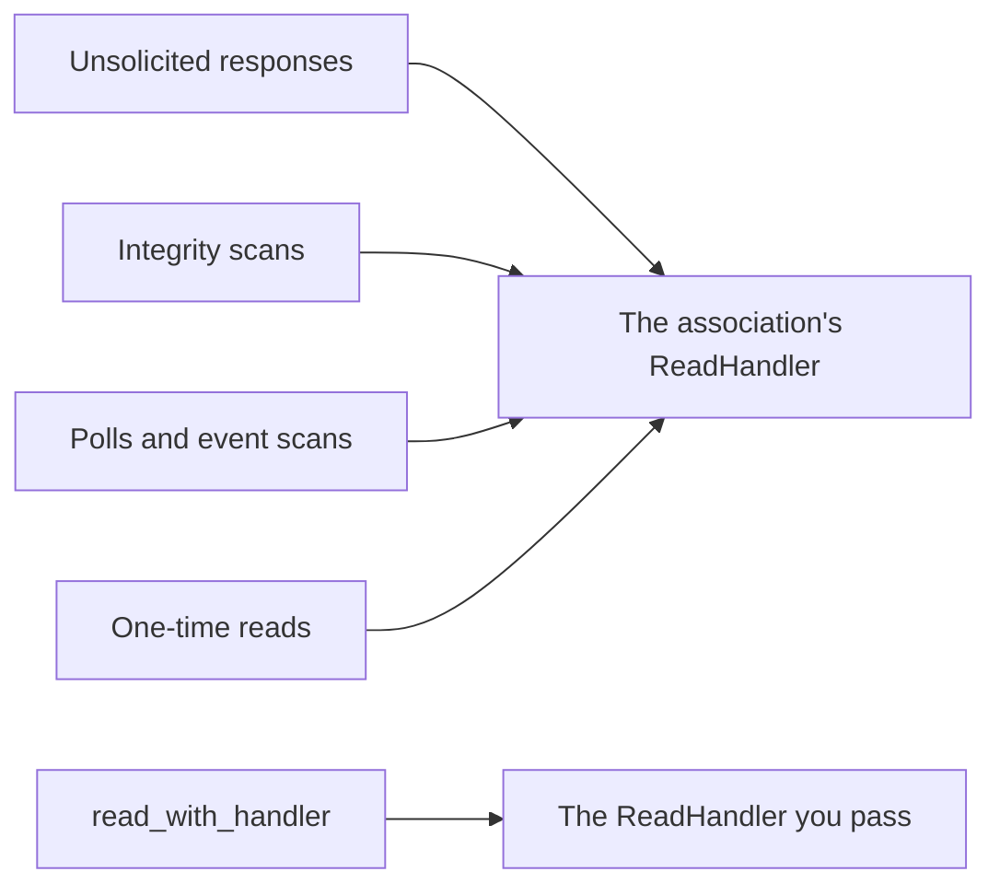

import Tabs from '@theme/Tabs';
import TabItem from '@theme/TabItem';

The `ReadHandler` interface receives measurement values from the outstation. Each association has one, which you supply
when you create it.

## Where values come from

Everything the association reads goes to its `ReadHandler`, except a read you send with your own handler:



The `begin_fragment` and `end_fragment` callbacks receive a read type that tells you which of these the values came from:

| Read type | Values from |
|-----------|-------------|
| `Unsolicited` | Unsolicited responses |
| `StartupIntegrity` | The integrity scans the master runs on its own: at startup, after the outstation restarts, and after an event buffer overflow |
| `PeriodicPoll` | Your [polls](./association_polls.mdx), and the automatic event scans |
| `SinglePoll` | [One-time reads](./association_polls.mdx#one-time-reads), including `read_with_handler` |

See [Scheduling](./scheduling.mdx) for when the master runs integrity and event scans on its own.

## Callbacks

For every READ response or unsolicited fragment the master accepts, even one without any objects, `ReadHandler` callbacks
are executed in the following order:

1. `ReadHandler::begin_fragment`
2. `ReadHandler::handle_<TYPE>` for each object header in the message
3. `ReadHandler::end_fragment`

The begin and end methods receive the read type and the full header of the response.

:::tip
To determine if a measurement is a static value or an event, use the `HeaderInfo::is_event` field.
:::

Each value has a set of associated flags. In Rust, check for a flag with `Flags::is_set` and the constants on `Flags`, such
as `Flags::ONLINE`. In the bindings, compare the `Flags::value` field with the constants defined in `Flag`.

:::tip
It's common to maintain a list of measurement values in your `ReadHandler` implementation. You can then use the `end_fragment` method as a trigger to publish them.
Since responses may consist of multiple fragments, you can inspect the `ResponseHeader.Control.Fin` field to determine if the current fragment is the final fragment
in a response series.
:::

The `ReadHandler` also receives [device attributes](./attributes.mdx#receiving-attributes).

## Examples

The example below shows an implementation of a `ReadHandler` that prints every value and device attribute it receives to
the console.

<Tabs
groupId="language"
defaultValue="Rust"
values={[
{label: 'Rust', value: 'Rust'},
{label: 'C', value: 'C'},
{label: 'C++', value: 'C++'},
{label: 'Java', value: 'Java'},
{label: 'C#', value: 'C#'},
]}>
<TabItem value="Rust">

```rust
{{#include ../examples/master/src/main.rs:read_handler}}
```

</TabItem>
<TabItem value="C">

```c
{{#include ../ffi/bindings/c/master_example.c:read_handler}}
```

</TabItem>
<TabItem value="C++">

```cpp
{{#include ../ffi/bindings/c/master_example.cpp:read_handler}}
```

</TabItem>
<TabItem value="Java">

```java
{{#include ../ffi/bindings/java/examples/src/main/java/io/stepfunc/dnp3/examples/MasterExample.java:read_handler}}
```

</TabItem>
<TabItem value="C#">

```csharp
{{#include ../ffi/bindings/dotnet/examples/master/Program.cs:read_handler}}
```

</TabItem>
</Tabs>
