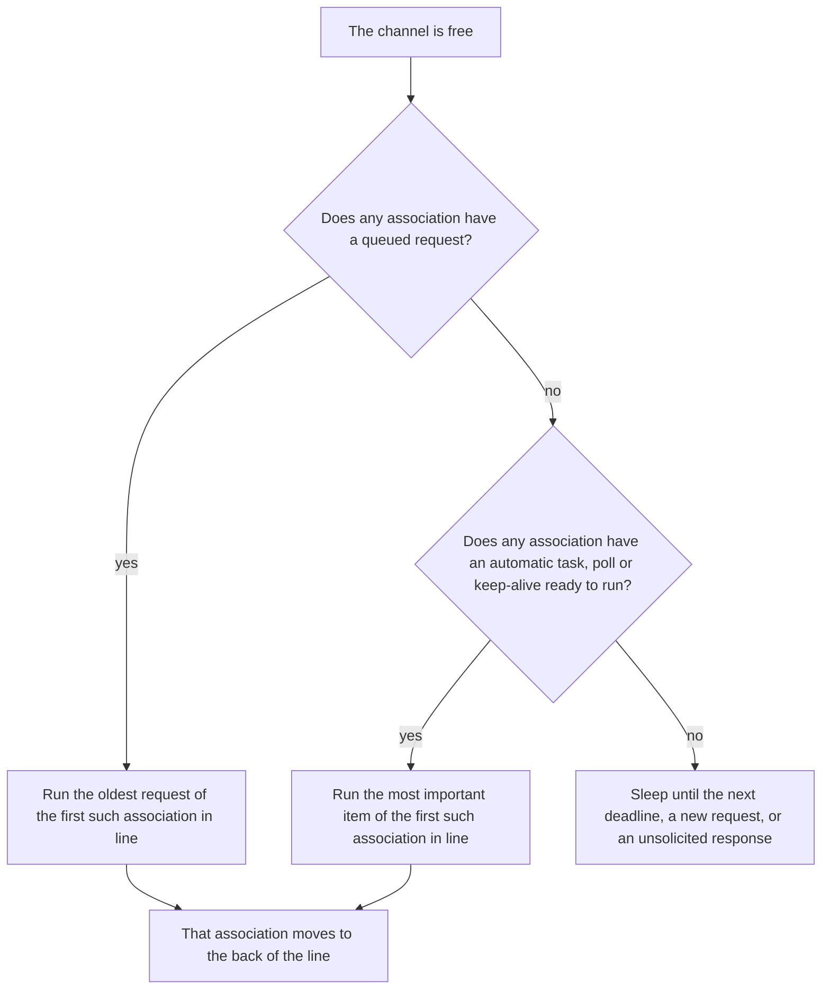

A master does more than send the requests you ask for. Each association runs a startup sequence, reacts to the IIN bits the
outstation reports, and can check that a quiet link is still alive. This page explains what the master does on its own, how
that fits around your polls and requests, and how a channel decides what to send next, so that you can predict the traffic
you'll see on the wire.

The behavior is the same in Rust and in every binding. The settings mentioned below are part of the
[AssociationConfig](./association_config.mdx); their names follow your language's conventions, and their defaults are in the
API documentation.

## What the master does on its own

Each association has its own set of automatic tasks. The master schedules one when something happens on the connection,
usually a bit in the IIN field of a response. The responses that count are unsolicited responses and the response to the
request the master is waiting for, whoever made it, if its fragment flags are valid for that request. A solicited response
that doesn't match that request is dropped. The table lists the tasks in the order an association runs them when several are
due.

| Task | When it's scheduled | Reference |
|------|---------------------|-----------|
| Clear the restart bit | When a response reports DEVICE_RESTART (IIN1.7) | IEEE 1815-2012 4.5.8, 5.1.1.1.2 |
| Disable unsolicited reporting | When the association starts communicating | IEEE 1815-2012 5.1.1.2 |
| Time synchronization | When a response reports NEED_TIME (IIN1.4) and automatic time synchronization is configured | IEEE 1815-2012 4.5.5, 5.1.1.2, 10.3 |
| Startup integrity scan | When the association starts communicating, after an outstation restart, and on an event buffer overflow (IIN2.3) if enabled | IEEE 1815-2012 5.1.1.2, TB2017-005 |
| Enable unsolicited reporting | When the association starts communicating, and after an outstation restart | IEEE 1815-2012 5.1.1.2 |
| Event scan | When a response reports events (IIN1.1 to IIN1.3) in a class enabled for automatic event scans | IEEE 1815-2012 4.5.2 to 4.5.4 |
| Keep-alive | When nothing has been received from the outstation for the keep-alive timeout, if one is configured | IEEE 1815-2012 13.2.3.3.1 |

The keep-alive is a link-layer request rather than an application-layer task, and it comes after the association's polls.
A time synchronization that failed and is waiting to be retried doesn't hold up anything else, as described
[below](#time-synchronization).

"Starts communicating" means each time the channel connects with the association on it, and when you add an association to
a channel that is already connected. The startup sequence runs again after every reconnect.

### Startup

The startup sequence is the [initialization](./association_config.mdx#initialization) described with the
`AssociationConfig`: disable unsolicited reporting, synchronize the time if the outstation asks for it, read the startup
integrity classes, then enable unsolicited reporting, in the order of IEEE 1815-2012 5.1.1.2. The unsolicited and integrity
steps are each skipped if their classes are empty, so an association configured with no unsolicited classes and no
integrity classes only synchronizes the time, if asked to.

If startup integrity classes are configured, the master ignores unsolicited responses that carry data until the integrity
scan completes, and doesn't confirm them, so the outstation sends them again later. TB2015-002a describes how a master handles
unsolicited responses during startup. Its master state table (IEEE 1815-2012 Table 6-3, as replaced by the bulletin) discards
a startup response without DEVICE_RESTART; this master instead accepts and confirms a null unsolicited response at any time,
even without DEVICE_RESTART, which avoids a timeout race with an outstation that holds back its answer to the
integrity scan until its null response is confirmed.

### Outstation restart

When a response reports DEVICE_RESTART (IIN1.7), the master writes to clear the bit, synchronizes the time if the outstation
asks for it, then repeats the startup integrity scan and enables unsolicited reporting again. It doesn't send
DISABLE_UNSOLICITED this time. If the bit arrives while the integrity scan or ENABLE_UNSOLICITED is in progress, for example
in the response to the integrity scan itself, that run doesn't count: the master clears the bit and runs them again, as
IEEE 1815-2012 5.1.1.1.2 has the procedure recommence. Unsolicited responses with data are ignored again until the integrity
scan completes.

### Event scans

When automatic event scans are enabled for some classes, a response that reports events in one of those classes schedules an
event scan, unless one is already pending. The scan reads the classes that are both reported and enabled. Its data reaches
your [ReadHandler](./read_handler.mdx) like the data of a periodic poll.

An outstation may have more events than fit in one response. If the scan returned events, its last response still reports
events in an enabled class, and the outstation didn't reject any part of the scan with an IIN2 request error
(NO_FUNC_CODE_SUPPORT, OBJECT_UNKNOWN or PARAMETER_ERROR, IIN2.0 to IIN2.2) in any of its fragments, the scan runs again at
once, reading the classes that response reported. Otherwise the scan is done, and only a later response that reports events
schedules the next one. So an outstation that keeps an event bit set without returning events, or that rejects the scan,
doesn't make the master scan back to back. Other IIN2 bits, such as CONFIG_CORRUPT, don't stop the scan from
running again.

### Time synchronization

When automatic time synchronization is configured, NEED_TIME (IIN1.4) in a response schedules it, using the configured
procedure. It succeeds when the outstation's answer to the time write no longer reports NEED_TIME. If the outstation still
asks for the time, doesn't answer, or the [AssociationHandler](./association_handler.mdx) can't provide the time, the master
retries later.

The time synchronization goes before the startup integrity scan only until it fails. Unlike the other automatic tasks, a
failed time synchronization doesn't hold up the rest of the association while it waits for its retry: the integrity scan,
unsolicited reporting, event scans, polls and the keep-alive all carry on, and the time synchronization retries on its own
schedule, after the startup integrity scan if that's still due. So a master without a clock, or an outstation that never
answers the time synchronization, doesn't stall the association. The time synchronization goes first again once it
succeeds, or when the association starts communicating again.

### Keep-alive

With a keep-alive timeout configured, the master sends a link-layer `REQUEST_LINK_STATUS` to the outstation once it has
received nothing from that outstation for the timeout. The keep-alive section [below](#keep-alive-timing) describes exactly
what restarts the timer.

## Your requests and polls

Two kinds of work come from you:

* **Requests**: everything you call on an association, such as reads, controls, time synchronization, restarts, file
  operations and link status checks. Each association queues its requests in the order you make them. The queue has a
  configurable limit; a request beyond it fails at once with a "too many requests" error. A request made while the channel
  isn't connected fails at once too, and requests still queued when the connection is lost fail. The master never retries a
  request; the result, success or failure, goes back to you.
* **Polls**: periodic reads that you [add to an association](./association_polls.mdx). A poll belongs to the association, not
  to the connection: polls keep their schedule across reconnects and only run while the channel is connected. Removing a
  poll stops it for good. Demanding a poll makes it due at once.

Unsolicited responses aren't scheduled at all. The master processes and confirms them as they arrive, even while it waits for
the response to another request, subject to the startup rule above.

## How a channel decides what runs next

A channel is one connection, and it may carry several associations. These rules, which are this library's design, decide
the order in which their work goes out.

### One request at a time

A channel has at most one request in flight. It sends the next one only after the current one completes, whether it succeeds,
fails or times out.

Some requests take several exchanges, and the channel stays with them until they finish: a select-before-operate, a time
synchronization, a read whose response spans several fragments, or a file transfer. While the master waits, it processes
unsolicited responses and API calls, but neither extends the wait. Each response must arrive within the association's
response timeout, measured from the request (or, in a multi-fragment read, from the previous fragment).

### Priorities and turns

When the channel is free, it picks the next request like this:

1. **Your requests come first.** A queued request of any association runs before the automatic tasks, polls and keep-alives
   of every association. Each association's requests run in the order you made them.
2. **Associations take turns.** The associations wait in a line, in the order they were added. When one of them starts a
   request, of any kind, it moves to the back of the line. So two associations with queued requests alternate, and so do two
   associations with polls due at the same time. A busy association can't hold up the others, but turns are counted in
   requests, not in time.
3. **Within an association, the order is fixed:** its automatic tasks, then its polls, then its keep-alive.
   The automatic tasks go in this order: clear the restart bit, disable unsolicited reporting, time synchronization,
   startup integrity scan, enable unsolicited reporting, event scan, except that a failed time synchronization retries
   after the startup integrity scan. An automatic task waiting to be retried blocks everything after it in the
   association, so an overdue poll or keep-alive isn't ready to run until that task is, unless the waiting task is the
   time synchronization (see [below](#what-retries-what-waits-and-what-fails)).

When nothing is ready to run, the master sleeps until the earliest deadline. A new request or an unsolicited response wakes it up.

### Polls

* **A poll first runs one period after its schedule starts**, normally when you add it, and then one period after each run
  completes. The next run is counted
  from the moment the run ends, not from when it was scheduled. If the outstation takes 3 seconds to answer a 10 second poll,
  the runs are 13 seconds apart. Time spent waiting for the channel delays the next run as well, so polls on a busy channel
  never pile up; they slow down.
* **A failed poll isn't retried sooner.** Whether it timed out or the outstation rejected it, the poll runs again one period
  after it failed, unless you demanded it while it ran.
* **A missed run isn't made up.** A poll that came due several times while the channel was busy or disconnected runs once.
* **Demanding a poll** makes it due at once. It runs at its association's next turn, after your queued requests, the
  association's automatic tasks and any due polls added before it. Its next run is one period after that run completes.
  Demanding a poll while it's running leaves it due again as soon as that run ends, whether it succeeds or fails.
* **The first poll added wins.** When an association has several polls due, it runs the one you added first, not the one
  that came due first. For example, a 10 second poll added before a 4 second poll on an otherwise idle association runs
  like this:

  | Time (s) | Poll that runs |
  |----------|----------------|
  | 4, 8 | 4 second poll |
  | 10 | 10 second poll |
  | 12, 16 | 4 second poll |
  | 20 | both are due: the 10 second poll first, then the 4 second poll |

### What retries, what waits and what fails

| Work | When it fails |
|------|---------------|
| Your requests | The error goes back to you. The master doesn't retry. |
| Polls | Nothing is retried. The poll runs again one period after it failed, or at once if it was demanded while it ran. |
| Automatic tasks | Retried after a delay, counted from the failure, that starts at the minimum of the retry strategy and doubles with each consecutive failure, up to its maximum. A success resets the delay. |
| Keep-alive | Due again as soon as it times out, and sent at the association's next turn, until the outstation answers. |

Some details:

* An automatic task fails when no response arrives in time, or the response can't be used. When the outstation answers
  but rejects it with IIN2 error bits, the task is done: the master moves on, because asking again wouldn't change the answer. The exceptions are clearing
  the restart bit, which is retried while the outstation still reports DEVICE_RESTART, and time synchronization, which is
  retried while the outstation still reports NEED_TIME or rejects the time.
* **While an automatic task waits to be retried, the rest of that association waits too:** its later automatic tasks, its
  polls and its keep-alive. Your requests to that association still run, and the other associations on the channel carry
  on. For example, if the outstation never answers the startup integrity scan, the association's polls don't run until it
  succeeds. There are two exceptions. A time synchronization waiting to be retried doesn't block anything. An event scan
  is skipped, and stops blocking, once a later response no longer reports events in its classes.
* An unanswered keep-alive doesn't close the connection. The master keeps asking, each time the previous one has timed out
  and the association gets its turn.

### Keep-alive timing {#keep-alive-timing}

Each association has its own keep-alive timer. The timer restarts whenever the master receives one of these from that
outstation:

* a response that the master can parse, solicited or unsolicited, including a response that arrives while the channel is
  busy with a request to another association;
* a link-layer message, such as the reply to `REQUEST_LINK_STATUS` or a link-layer request from the outstation.

A fragment that isn't a valid response, such as one too short for its header, doesn't restart it, and neither does part of a
fragment that hasn't been completed. A response with a valid header restarts it even if its objects are malformed. Requests the master
sends don't restart it either; only what it receives does.

Two consequences follow:

* **No keep-alives while polls are answered.** If the outstation answers a poll at least once per keep-alive timeout, the
  timer never expires. When a poll and the keep-alive fall due together, the poll goes first, and its response restarts the
  timer.
* **Keep-alives are per outstation.** On a channel with several associations, each one is checked on its own schedule, and
  traffic from one outstation doesn't keep another's timer alive.

## Practical consequences

**A slow or silent outstation delays the others.** With one request in flight per channel, every request to an outstation
that doesn't answer holds the channel for a full response timeout. On a multi-drop serial channel, an offline outstation
keeps costing time. If it goes silent after its startup sequence, each of its polls still runs, one period after the previous
run timed out or later if the channel is busy, and its keep-alive, if enabled, is sent again after each one times out. If it never answers its startup sequence, that task is retried with growing
delays. Keep the response timeout close to the slowest response you actually expect, rather than padding it generously.

**Size poll periods for the whole channel.** The time between two runs of a poll is its period plus the time it waits for the
channel plus its response time. As a rough check, add up the response times of everything the channel runs in one cycle,
using the response timeout for any outstation that might not answer. If that's close to or longer than your poll periods,
polls will run back to back and less often than configured.

**The first poll added can crowd out the others.** Because the first poll added wins among the polls that are due, a fast
poll added first can starve the later polls of its association when the channel is busy: if it's due again by the time the
association gets its next turn, it runs again, and the polls added after it keep waiting. Add polls in order of importance,
and give the fastest one a period longer than the time the channel needs to serve the other associations.

**Your requests can delay everything else.** Requests of every association go before automatic tasks and polls, so a steady
stream of requests delays polls, event scans and startup sequences on the whole channel. If you send requests in a loop,
wait for each one to complete before sending the next.

**A failing startup holds up polling.** If an outstation keeps failing a startup task, for example by never answering the
integrity scan, that association's polls stop until the task succeeds. A failing time synchronization is the exception: it
retries on its own without holding anything up. The
[AssociationInformation](./association_information.mdx) callbacks report the start and outcome of each application-layer task
the master sends, with its type, which usually shows which automatic task is failing. Keep-alives and link status checks
aren't reported. An automatic time synchronization that can't start because the system time is unavailable sends nothing,
but it's still reported as a time synchronization that starts and fails with the "system time not available" task error.
An answer to clearing the restart bit that still reports DEVICE_RESTART is reported as a failure, and the master retries it.
