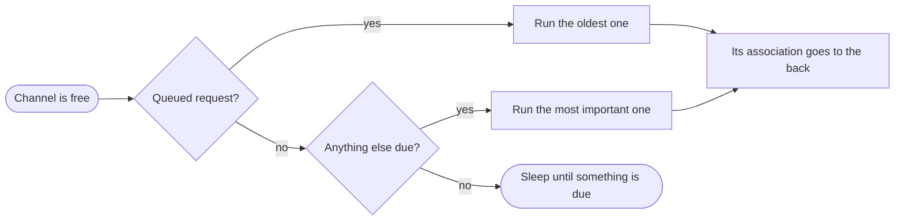

A master does more than send the requests you ask for. Each association runs a startup sequence, reacts to what the
outstation reports, and can check that a quiet link is still alive. This page gives the highlights of what the master does
on its own and how it fits that around your requests and polls, so that you can predict the traffic you'll see on the wire.

The behavior is the same in Rust and in every binding. The settings mentioned below are part of the
[AssociationConfig](./association_config.mdx).

## What the master does on its own

Each association has its own automatic tasks, listed here in the order it runs them when several are due:

| Automatic task | Runs when |
|----------------|-----------|
| Clear the restart bit | The outstation reports that it restarted |
| Disable unsolicited reporting | The association starts communicating |
| Time synchronization | The outstation asks for the time, if automatic time synchronization is configured |
| Integrity scan | The association starts communicating, and after the outstation restarts |
| Enable unsolicited reporting | The association starts communicating, and after the outstation restarts |
| Event scan | The outstation reports events in a class enabled for automatic event scans |
| Keep-alive | Nothing has been received from the outstation for the keep-alive timeout, if one is configured |

An association starts communicating each time the channel connects, including after a reconnect, and when you add it to a
channel that is already connected. The startup steps are the [initialization](./association_config.mdx#initialization)
configured in the `AssociationConfig`, and each one is skipped if its classes are empty.

## Your requests and polls

* **Requests** are everything you call on an association, such as reads, controls and restarts. They run in the order you
  make them, and the result, success or failure, goes back to you. A request fails at once if the channel isn't connected or
  the association already has too many queued.
* **Polls** are periodic reads that you [add to an association](./association_polls.mdx). They keep their schedule across
  reconnects. Each run is due one period after the previous run ends, so on a busy channel polls slow down rather than pile
  up, and a missed run isn't made up. Demanding a poll makes it due at once.

Unsolicited responses aren't scheduled: the master processes them as they arrive.

## How a channel decides what runs next

A channel is one connection, and it may carry several associations. It has one request in flight at a time, and stays with
an operation that takes several exchanges, such as a select-before-operate or a file transfer, until it finishes. When the
channel is free, it picks the next request like this:

1. **Your requests come first**, before the automatic tasks and polls of every association.
2. **Associations take turns**, so a busy association can't hold up the others.
3. **Within an association**, its automatic tasks go first, then its polls, then its keep-alive. When several polls are due,
   the one you added first runs first.

## When something fails

| Work | What happens |
|------|--------------|
| Your requests | The error goes back to you. The master doesn't retry. |
| Polls | The poll runs again one period later. |
| Automatic tasks | Retried after a delay that grows with each failure, within the retry strategy's bounds, unless the outstation rejects it. While one waits, the association's polls wait too. A failed time synchronization doesn't hold anything up. |
| Keep-alive | Sent again until the outstation answers. It doesn't close the connection. |

The [AssociationInformation](./association_information.mdx) callbacks report the start and outcome of each task except
keep-alives and link status checks, which shows which automatic task is failing.

## Tips

* **Keep the response timeout close to the slowest response you expect.** A silent outstation holds the whole channel for a
  full response timeout on every request, which delays every other association on the channel.
* **Size poll periods for the whole channel.** The time between two runs of a poll is its period, plus the time it waits for
  the channel, plus its response time. If the channel's work in one cycle takes about as long as your poll periods, polls
  run back to back and less often than configured.
* **Add polls in order of importance.** The first poll added wins when several are due, so on a busy channel a fast poll
  added first can crowd out the others.
* **Don't flood the channel with requests.** They go before every association's automatic tasks and polls, so wait for
  each request to complete before sending the next.
