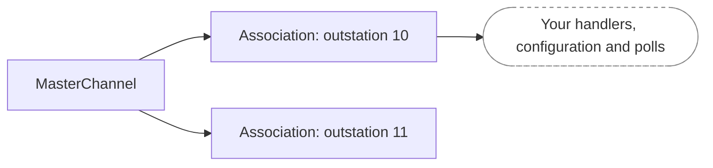

A master talks to outstations through **channels**, and to each outstation on a channel through an **association**:

| To | Use | See |
|----|-----|-----|
| Connect to outstations | A `MasterChannel` per TCP or TLS connection, serial port or UDP socket, or a server that accepts outstations that connect in | [Channel basics](./channel_config.mdx), [TCP server](./tcp_server.mdx) |
| Talk to one outstation | An association, added to the channel with the outstation's address | [Creating associations](./association_create.mdx) |
| Receive values | Your `ReadHandler` | [ReadHandler](./read_handler.mdx) |
| Read data | Polls on a schedule, or one-time reads | [Polls and one-time reads](./association_polls.mdx) |
| Operate outputs | Controls | [Controls](./controls.mdx) |
| Keep the outstation's clock right | Time synchronization | [Time synchronization](./association_handler.mdx) |
| Watch communication health | State listeners and `AssociationInformation` | [Channel basics](./channel_config.mdx), [AssociationInformation](./association_information.mdx) |
| Do anything else | Attributes, files, restarts, freezes, deadbands | [Attributes](./attributes.mdx), [File transfer](./file_transfer.mdx), [Other requests](./association_other.mdx) |

Setting up a master takes four steps: create a channel, add an association for each outstation, add polls to the
associations, and enable the channel. Until it's enabled, the channel doesn't communicate, so everything can be
configured first.

## Calling operations

In Rust, adding an association returns an `AssociationHandle`, and you call operations such as reads and controls on it.
In the bindings, it returns an `AssociationId`, and you pass that to the same operation on the `MasterChannel`. This
guide names each operation once; the API documentation has both forms.

:::note
It's typical to have one association per channel over TCP, but a single TCP endpoint can also host several virtual
outstations. Serial channels are often part of a multi-drop network, where one serial channel talks to several
independent outstations.
:::
