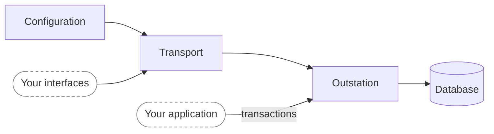

An outstation needs three things:

1. **Configuration**: its DNP3 address, the master's address, its event buffer sizes and how it behaves.
2. **Your interfaces**: the callbacks the outstation uses to ask your application for what only it knows, such as
   `OutstationApplication` and `ControlHandler`.
3. **A transport**: a TCP or TLS server that hosts one or more outstations, a TCP or TLS client, a serial port, or UDP.

Creating the outstation on its transport gives you an `Outstation`. That's the handle your application keeps for as long
as the outstation runs: you update the points in its database through it, and enable, disable or adjust it while it runs.

The pages in this section follow the same order: [configuration](./configuration.mdx), the
[interfaces](./control_handler.mdx), the [transports](./tcp_server.mdx), and then the [Outstation](./outstation.mdx)
and its [database](./database.mdx).
