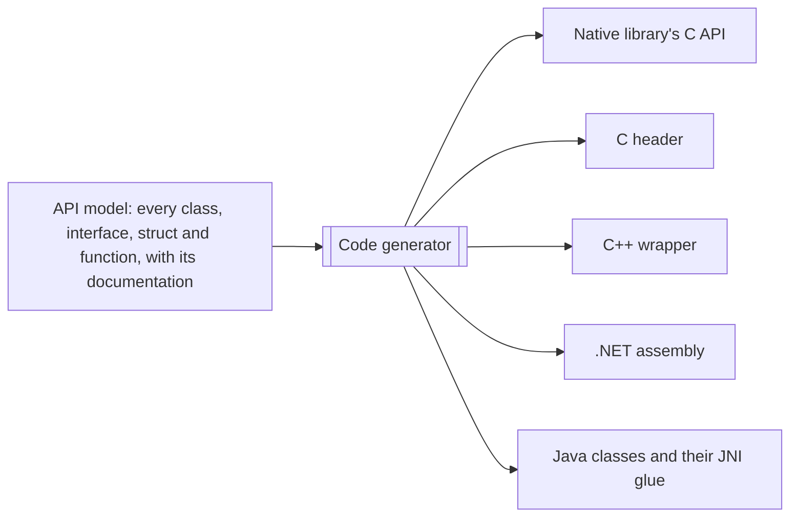
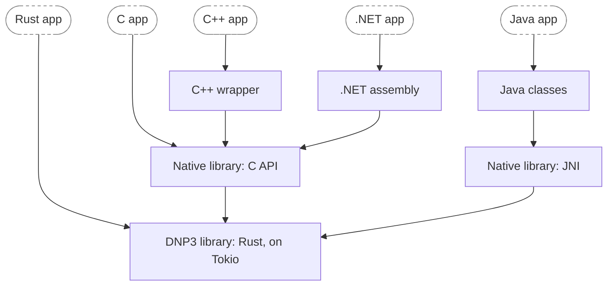

The library is written in Rust, and Rust programs use it directly. Every other language uses bindings generated from a
single description of the API, so C, C++, .NET and Java get the same features and the same documentation, each in the style
of that language.

## One model, every language

We describe each class, interface, struct and function of the API, with its documentation, once in a model. Our code
generator, [oo_bindgen](https://github.com/stepfunc/oo_bindgen/), turns that model into the code for each language:

Because everything comes from the same model, a feature reaches every language in the same release, and the bindings
can't drift apart. Our [blog post](https://stepfunc.io/blog/bindings/) explains the approach in more depth.

## What runs in your application

Whatever language you use, every call ends up in the same Rust code, so a master or an outstation behaves the same in
every language. Only the thin layer that you call is different:

## Terms used in this guide

The guide describes the API with general terms. This is what each one is in your language; the language pages have
the details. The Rust API is ordinary Rust rather than generated, so its column shows the closest equivalent.

| Term | C | C++ | Java | .NET | Rust |
|------|---|-----|------|----|------|
| Class | Opaque pointer | Move-only class | Class | Class | Struct |
| Interface | Function pointers | Abstract class | Interface | Interface | Trait |
| Struct | Struct | Struct | Class | Class | Struct |
| Iterator | Iterator | Iterator | `List<T>` | `ICollection<T>` | `Iterator` |
| Async method | Callback | Callback | `CompletionStage<T>` | `Task<T>` | `async fn` |
| Error | Error code | Exception | Exception | Exception | `Result` |

In C and C++, an iterator is valid only inside the callback that receives it. Java and .NET copy the values into a
collection that you can keep.
